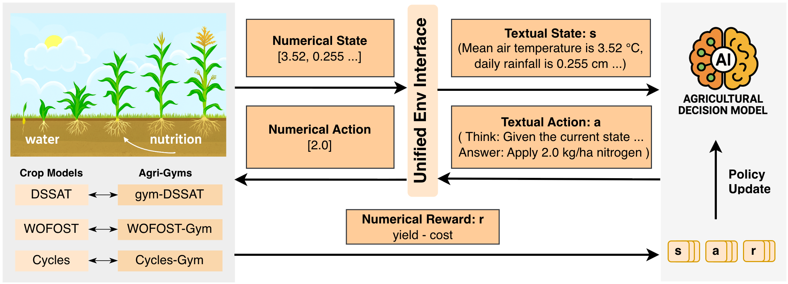

# AgriManager

**A Framework and Benchmark for LLM-RL Generalization in Agricultural Management**

[Website](TODO(website-url)) · [Paper](TODO(paper-url)) · [Models & Data](https://huggingface.co/AgriManager-Framework) · [Training logs](https://wandb.ai/agrimanager) · [Docs](docs/README.md)



Farms differ in what a manager can observe, which actions are available, and
which objective counts. AgriManager studies whether one language-model policy
trained with reinforcement learning can generalize across these differences.
We call a change in the observation, action or objective schema between
training and deployment a **schema shift**, written
Σ = (Σ<sub>O</sub>, Σ<sub>A</sub>, Σ<sub>R</sub>), and study it alongside the
familiar **distribution shift** in weather, crops and prices.

- **Framework.** Three process-based crop simulators (DSSAT, WOFOST and
  Cycles) behind one text interface. The schema is written in the prompt, so a
  single policy can read a new observation set, action menu or objective. RL
  training runs on VeRL (GRPO by default; DrGRPO and PPO also tested) with
  Qwen and Llama backbones.
- **Benchmark.** Eight settings in three tiers: Within Schema (weather, crop,
  price), Single-Axis Schema (observation, action menu, objective) and
  Compositional Schema (cross-simulator transfer, unified policy). Every
  setting has a frozen held-out test suite with manifests, generation configs,
  seeds and disjointness audits.
- **Unified training and evaluation.** LLM agents and neural-network policies
  (PPO, A2C, DQN, MaskablePPO) are trained in one framework on the same
  simulators, and every policy, scripted baselines included, is scored on the
  same held-out scenarios and reported in the same tables. A new policy of any
  kind can be compared directly with everything in the paper.

This repository accompanies the NeurIPS 2026 Evaluations and Datasets track
paper *AgriManager: A Framework and Benchmark for LLM-RL Generalization in
Agricultural Management* (`TODO(paper-url)`: proceedings and arXiv links).

## Models, training curves and test sets

Every checkpoint scored in the paper, its training run, and the test split it
was scored on. Models and datasets are on the
[AgriManager-Framework](https://huggingface.co/AgriManager-Framework) Hugging Face
organization; training curves are on [Weights & Biases](https://wandb.ai/agrimanager).

| Tier | Setting | Models | Training curves | Test set |
|---|---|---|---|---|
| Tier 1 · Within Schema | T1.1 Weather regime | [Models](https://huggingface.co/collections/AgriManager-Framework/t11-weather-regime-6ade3b9d93dd1f22d1a1a49b) | [Training curves](https://wandb.ai/agrimanager/t1-1-weather-regime) | [Test set](https://huggingface.co/datasets/AgriManager-Framework/agrimanager-test-suite/tree/main) |
|  | T1.2 Crop variety | [Models](https://huggingface.co/collections/AgriManager-Framework/t12-crop-variety-6ade3b9fffe165f18441da59) | [Training curves](https://wandb.ai/agrimanager/t1-2-crop-variety) | [Test set](https://huggingface.co/datasets/AgriManager-Framework/agrimanager-test-suite/tree/main/e4_t12_cross_crop) |
|  | T1.3 Price regime | [Models](https://huggingface.co/collections/AgriManager-Framework/t13-price-regime-6ade3ba1f90654ac2bd63ca7) | [Training curves](https://wandb.ai/agrimanager/t1-3-price-regime) | [Test set](https://huggingface.co/datasets/AgriManager-Framework/agrimanager-test-suite/tree/main/e4_t13_price_regime) |
| Tier 2 · Single-Axis Schema | T2.1 Observation schema | [Models](https://huggingface.co/collections/AgriManager-Framework/t21-observation-schema-6ade3ba28e3e2ca978d0ba6d) | [Training curves](https://wandb.ai/agrimanager/t2-1-observation-schema) | [Test set](https://huggingface.co/datasets/AgriManager-Framework/agrimanager-test-suite/tree/main/e4_t21_observation_schema) |
|  | T2.2 Action menu | [Models](https://huggingface.co/collections/AgriManager-Framework/t22-action-menu-6ade3ba2d49bbdd8dd7ef3ba) | [Training curves](https://wandb.ai/agrimanager/t2-2-action-menu) | [Test set](https://huggingface.co/datasets/AgriManager-Framework/agrimanager-test-suite/tree/main/e4_t22_action_menu) |
|  | T2.3 Objective | [Models](https://huggingface.co/collections/AgriManager-Framework/t23-objective-6ade3ba4f90654ac2bd63df8) | [Training curves](https://wandb.ai/agrimanager/t2-3-objective) | [Test set](https://huggingface.co/datasets/AgriManager-Framework/agrimanager-test-suite/tree/main/e4_t23_reward_formulation) |
| Tier 3 · Compositional Schema | T3.1 Cross-simulator transfer | [Models](https://huggingface.co/collections/AgriManager-Framework/t31-cross-simulator-transfer-6ade3ba5b04b81f86ad2e4c7) | [Training curves](https://wandb.ai/agrimanager/t3-1-cross-simulator) | [Test set](https://huggingface.co/datasets/AgriManager-Framework/agrimanager-test-suite/tree/main) |
|  | T3.2 Unified policy | [Models](https://huggingface.co/collections/AgriManager-Framework/t32-unified-policy-6ade3ba7acc7c9c710e0bb0b) | [Training curves](https://wandb.ai/agrimanager/t3-2-unified-policy) | [Test set](https://huggingface.co/datasets/AgriManager-Framework/agrimanager-test-suite/tree/main) |
| Exploratory | Other backbones and RL algorithms | [Models](https://huggingface.co/collections/AgriManager-Framework/exploratory-backbones-and-rl-algorithms-6ade3ba8d49bbdd8dd7ef45f) | [Training curves](https://wandb.ai/agrimanager/exploratory-backbones-algorithms) | — |

Per-run results (every scored episode) are in the `schema-results-*` datasets of the
[Datasets collection](https://huggingface.co/collections/AgriManager-Framework/datasets-6ade3ba9f90654ac2bd63e95); the tables behind every
number in the paper are in [`results/tables/`](results/tables/).

## Where to start

| I want to | Read |
|---|---|
| Install the code and simulators | [docs/getting-started/install.md](docs/getting-started/install.md) |
| Run something in five minutes on a CPU | [docs/getting-started/quickstart.md](docs/getting-started/quickstart.md) |
| Understand the eight settings | [docs/benchmark/README.md](docs/benchmark/README.md) |
| Score my own policy on the held-out test suite | [docs/guides/evaluation.md](docs/guides/evaluation.md) |
| Reproduce a table or figure of the paper | [docs/guides/reproduce.md](docs/guides/reproduce.md) |
| Know how the test suite was built and audited | [docs/benchmark/test_suite.md](docs/benchmark/test_suite.md) |
| Download released checkpoints and data | [docs/release/models_and_data.md](docs/release/models_and_data.md) |
| Read the known limitations | [docs/faq.md](docs/faq.md) |

The full documentation index is [docs/README.md](docs/README.md).

## Install in short

```bash
git clone --recursive https://github.com/AgriManager-Framework/AgriManager.git
cd AgriManager
conda create -n agrimanager python=3.12 -y     # or: uv venv --seed -p 3.12 && source .venv/bin/activate
conda activate agrimanager
bash install.sh --cpu    # CPU only: WOFOST + Cycles, baselines, dataset building, tests
bash install.sh --gpu    # full stack for GRPO training and model scoring (CUDA 12.8)
```

Both modes pin every dependency: the VeRL submodule, WOFOST-Gym and CycleGym at
fixed commits (cloned into `../AgriManagerExternal/`), and the Python packages
(`requirements/cpu.txt` with `requirements/locks/agrimanager-py312-cpu.lock.txt`,
or `requirements/locks/agrimanager-py312-cu128.lock.txt`).
`install.sh` does not build the DSSAT runtime; follow
[docs/getting-started/install_dssat.md](docs/getting-started/install_dssat.md)
for DSSAT-backed settings. Hardware needs and environment variables are listed
in [docs/getting-started/install.md](docs/getting-started/install.md).

## Quickstart (CPU only)

```bash
bash smoke_tests/wofost_gym/run_cpu_quickstart.sh
```

This builds eight maize scenarios from the public maize weather pool and scores
two scripted policies on them (no-action and the scripted agronomic reference).
It needs `install.sh --cpu` but no GPU and no model download. See
[docs/getting-started/quickstart.md](docs/getting-started/quickstart.md) for
the expected output and the next steps.

## Repository layout

```text
agrimanager/            Python package
├── adapter/            VeRL adapter: agent loop, interactions, trainer, reward
├── checkpoint/         publishing checkpoints and scoring them on the test suite
├── env/                environment adapters (wofost_gym, gym_dssat, cycles_gym)
├── model_interface/    provider configs, models, server helpers
├── nn_ppo/             numeric baselines (PPO, MaskablePPO, A2C, DQN)
└── rollout/            batched rollouts and scripted baselines
entrypoints/            stable commands: dataset build, train, eval, tools
experiments/            one directory per benchmark setting, with fixed run scripts
smoke_tests/            small end-to-end checks per simulator
integrations/           AgriManager-side tools for external simulators
analysis/test_suite/    scripts that turn scored test-suite runs into the paper's tables
results/                the paper's tables (CSV), figures and the list of scored checkpoints
tests/                  unit tests (pytest)
docs/                   documentation
requirements/           pinned dependencies (CPU list, CPU and CUDA lock files)
install.sh              environment bootstrap (--cpu | --gpu)
```

## Citation

If you use AgriManager, please cite the paper. A machine-readable entry is in
[CITATION.cff](CITATION.cff).

```bibtex
@inproceedings{agrimanager2026,
  title     = {AgriManager: A Framework and Benchmark for {LLM-RL} Generalization
               in Agricultural Management},
  author    = {TODO(authors)},
  booktitle = {Advances in Neural Information Processing Systems (NeurIPS),
               Evaluations and Datasets Track},
  year      = {2026},
}
```

Please also cite the simulators and frameworks AgriManager builds on; see
[docs/reference/upstream_citations.md](docs/reference/upstream_citations.md).

## License

The code is licensed under the [Apache License 2.0](LICENSE) (see also
[NOTICE](NOTICE)). The datasets we publish are licensed under CC BY 4.0, and the
released model weights under Apache-2.0, except checkpoints fine-tuned from a
base model whose license says otherwise (Llama 3.2, Qwen2.5-3B). Simulators and
wrappers are not vendored; each keeps its own license, listed in
[THIRD_PARTY_NOTICES.md](THIRD_PARTY_NOTICES.md). The native Cycles simulator
binary that CycleGym downloads at install time is distributed under
CC BY-NC-ND 4.0.

## Contributing

Developer conventions (experiment layout, run scripts, configs) are in
[CONTRIBUTING.md](CONTRIBUTING.md).
